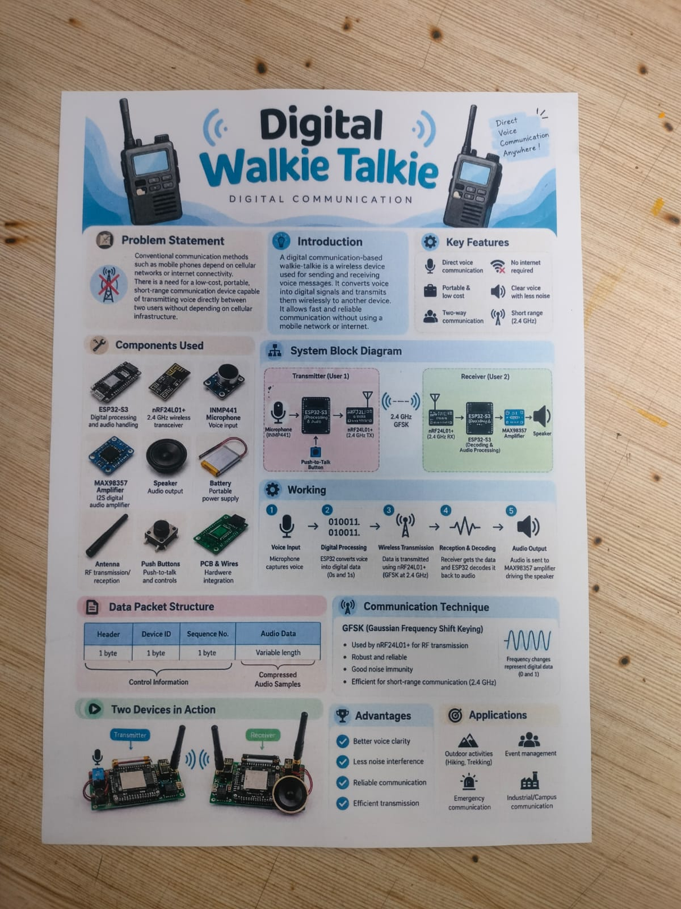
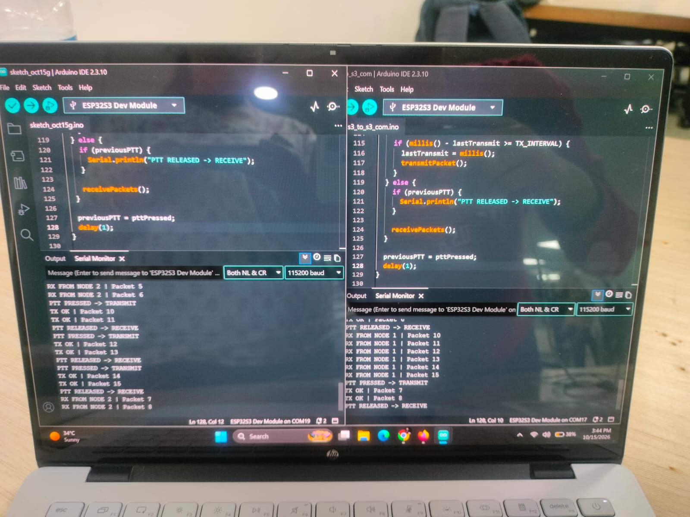
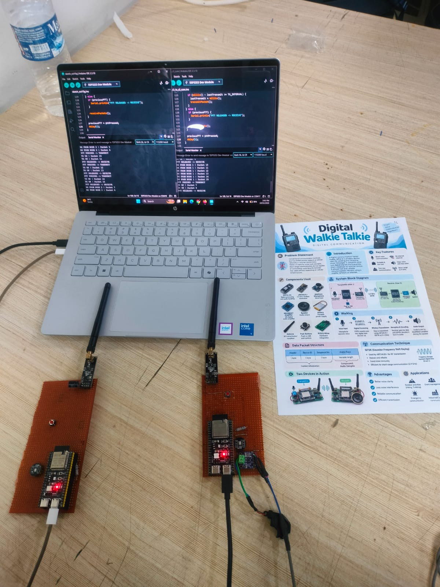
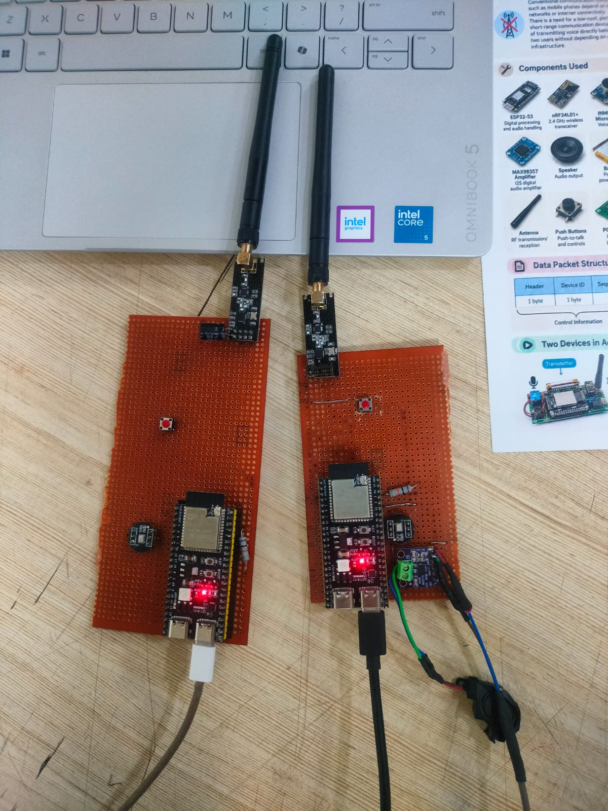

# Digital Walkie-Talkie

A Digital Communication mini project implementing an ESP32-S3-based wireless walkie-talkie using the NRF24L01+ RF transceiver.

## Project Overview

This project focuses on designing and implementing a digital wireless communication system that enables voice transmission between two devices. It uses ESP32-S3 microcontrollers for processing and NRF24L01+ modules for wireless data transmission.

## Objectives

- To understand digital wireless communication.
- To implement wireless data transmission using NRF24L01+.
- To interface digital audio components with ESP32-S3.
- To develop a push-to-talk communication system.

## Hardware Components

- ESP32-S3 development boards
- NRF24L01+ 2.4 GHz RF transceiver modules
- INMP441 digital MEMS microphone
- MAX98357A I2S audio amplifier
- Speaker
- Battery and power supply
- Push-to-talk buttons
- Antennas and connecting wires

## Working Principle

1. The INMP441 microphone captures voice as digital audio samples through the I2S interface.
2. The ESP32-S3 processes the audio data and prepares it for transmission.
3. The NRF24L01+ transceiver sends the data wirelessly using the 2.4 GHz band.
4. The receiving NRF24L01+ module transfers the received data to the second ESP32-S3.
5. The MAX98357A amplifier converts the received digital audio into an amplified speaker output.
6. Push-to-talk buttons control the transmission and reception process.

## Communication Technique

- Wireless frequency band: 2.4 GHz
- RF transceiver: NRF24L01+
- Modulation: GFSK
- Audio interface: I2S
- Wireless communication: Half-duplex

## Applications

- Industrial communication
- Warehouse coordination
- Event management
- Security and surveillance teams
- Campus communication
- Emergency and disaster management

## Limitations

- Communication range depends on the environment and antenna.
- Interference may occur in the 2.4 GHz band.
- Audio quality depends on processing and transmission conditions.
- Battery capacity limits operating time.
- Half-duplex communication allows one-way transmission at a time.

## Future Scope

- Improving wireless communication range.
- Enhancing audio quality and reducing latency.
- Implementing noise reduction.
- Optimizing power consumption.
- Developing a compact PCB-based design.

## Project Documentation

- Project Presentation: `project_presentation.pdf`
- Project Report: `project_report.docx`

## Project Team

- Vishakha Kirange
- Sanket Pawar
- Pranjal Sawant
- Vishal Gawali

## Related Project

Wireless DSP-based signal filtering using ESP32-S3 and NRF24L01+.

## Project Gallery

### 1. Project Poster

### 2. Code Implementation

### 3. Complete Project Setup

### 4. Hardware Prototype

### Related Project: Wireless Walkie-Talkie Filtering Using DSP

Both projects are interconnected and use ESP32-S3 and NRF24L01+ modules. While the Digital Walkie-Talkie project focuses on wireless voice communication, the DSP project focuses on processing signals using an IIR Low-Pass Filter. Together, they demonstrate wireless communication and digital signal processing.

[Explore the DSP Project](https://github.com/Vishakha1025/Wireless_Walkie_Talkie_Filtering)
